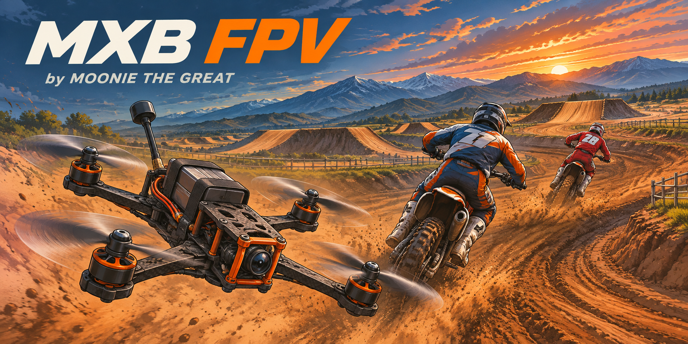

# MXB FPV

Fly an FPV drone in MX Bikes and chase your friends around the track. Made by **Moonie the Great**.

**[Download v1.1 installer](https://github.com/mooniethegreat/mxb-fpv-releases/releases/download/v1.1/MXB-FPV-1.1-Setup.exe)** · **[All downloads](https://github.com/mooniethegreat/mxb-fpv-releases/releases/tag/v1.1)** · **[Report a problem](https://github.com/mooniethegreat/mxb-fpv-releases/issues)**

**Multiplayer is tested and working on public servers.** Supports Windows 64-bit and MX Bikes beta 21e (Steam build 23566986).

**v1.1 is the stable release.** This update addresses distant riders disappearing, drone sharing recovery, remote movement smoothing, duplicate maps and confusing update messages. See [v1.1 release notes](CHANGELOG-1.1.md).

## Install and fly

1. Close MX Bikes.
2. Download the installer above, open it, and select the folder containing `mxbikes.exe`.
3. Click **Install**, then start the game yourself.
4. Open the game's **Settings**, then **FPV Drone [F9]**. Connect your USB FPV radio or gamepad and check the live input bars.
5. Join the track and press **F8** to spawn beside your bike and fly. Press F8 again to return.

**R** resets a crashed drone. **Escape**, pausing or losing focus returns you to the bike. You can bind a radio switch instead of F8. Click **Save** after changing settings.

Joined during a race? From the multiplayer pit screen, click **Fly FPV** beside Select Gate on Event Info, or in the bottom bar on other tabs. F8 also starts drone spectator mode from the pits. Your bike stays out of the race; F8 or Escape returns you to the pits.

Your drone is green and other drones are orange. With MaxHUD's map enabled, FPV adds drone icons to that map. Without a HUD map, it draws a standalone track map with numbered riders. **M** toggles the FPV map/markers while riding or flying; options are under **Audio & display → Map**. The controls sit at bottom center with drone speed close to their right.

DJI FPV radio defaults: roll axis 0, pitch axis 1, yaw axis 3, throttle axis 2. Your saved mapping stays in place when you update.

## What you can change

- Live receiver mapping, inversion, deadband and a radio mode switch.
- Betaflight, Raceflight, KISS, Actual and Quick rates, with separate curves for each axis.
- Throttle mid/expo/limit and optional reversible **3D mode**.
- 3-inch and 5-inch freestyle, 5-inch race, cinewhoop, Pavo20-inspired and DJI FPV-inspired presets. Tune props, battery, mass, thrust, camera tilt and FOV yourself.
- Drone sound, nearby drone volume, goggles/controller appearance and the mapped control display.

The bike brakes while you fly. The drone has terrain contact, bounce and crashes against approximate bike/rider collision volumes. The FPV dashboard shows drone speed in your chosen game units.

## Multiplayer

Install **0.6 or later on every PC that wants to see and hear drones**, then join the same server. Automatic sharing uses the existing game connection. Public-server multiplayer has been tested successfully; the server needs no modification or extra relay.

People without the mod can still ride while you chase them. They cannot see the custom drones, goggles or controller, or hear the drone audio. Installing only on the host does not add these features to unmodified clients.

Both pilots should install **v1.1** for the sharing recovery changes. The Multiplayer page shows connected/flying pilots and provides drone/rider smoothing sliders. Rider update priority follows the drone while flying, so your parked bike stays at spawn. A manual UDP relay remains available as a fallback.

## Updates and removal

**Settings → FPV Drone → Updates** shows the version actually running and the newest published version. It says **Up to date** when no update is needed, and **Ready to install** after a download. Checks run in the background with a six-hour cache; a changed plugin version or **Check for updates** refreshes it immediately. **v1.1 is on the stable channel**; no early-release option is needed.

Downloads happen only when you click **Download verified installer**. The checker verifies file size, SHA-256 and game-build compatibility. Open the download folder, close the game, then run Setup. It preserves your radio mapping and keeps the previous plugin; **Roll back** restores it. Nothing installs automatically while you play.

To remove the mod, close the game and choose **Uninstall** in Setup. Your settings and logs are kept. Other mods and the game executable are left alone.

## Known limits

Scenery meshes such as fences and overhead bridges are not part of the collision backend yet. Bike/rider contacts crash the drone; they do not force another player's bike to fall. Aircraft presets are approximations. Private game hooks are tied to the supported executable, so a game update may require a new mod build.

Smoothing reduces visible steps but cannot remove server lag or recover completely missing rider data. MaxHUD integration is checked against the supported plugin build; other map plugins are left alone. v1.1 was compiled and inspected offline; in-game multiplayer testing is being handled by the players.

If something goes wrong, [open an issue](https://github.com/mooniethegreat/mxb-fpv-releases/issues) with what happened, your mod/game version and `plugins/mxb_fpv.log`. Please leave passwords and server access details out of reports.

## Source and credits

Source is in [mod](mod). Build with Visual Studio 2022 C++ Build Tools and a Windows 10/11 SDK: `./mod/build.ps1 -SkipTests`. [Release packaging](RELEASING.md) describes how the updater gets its information. The bike-switch mod is a separate project.

Thanks to [Kino / trbflxr](https://github.com/trbflxr/kino) for the original drone sound samples, [MinHook](https://github.com/TsudaKageyu/minhook), [Dear ImGui](https://github.com/ocornut/imgui) and [FrostMod](https://github.com/Frostn1/frostmod). See [third-party notices](mod/THIRD-PARTY-NOTICES.txt) and [audio provenance](mod/assets/audio/PROVENANCE.txt). Original assets remain credited to their creators; this repository does not claim ownership of them.

Unofficial community mod. Not affiliated with PiBoSo, DJI, BETAFPV or Betaflight. The cover is illustrated artwork, not a gameplay screenshot; [artwork details](assets/COVER.md).
